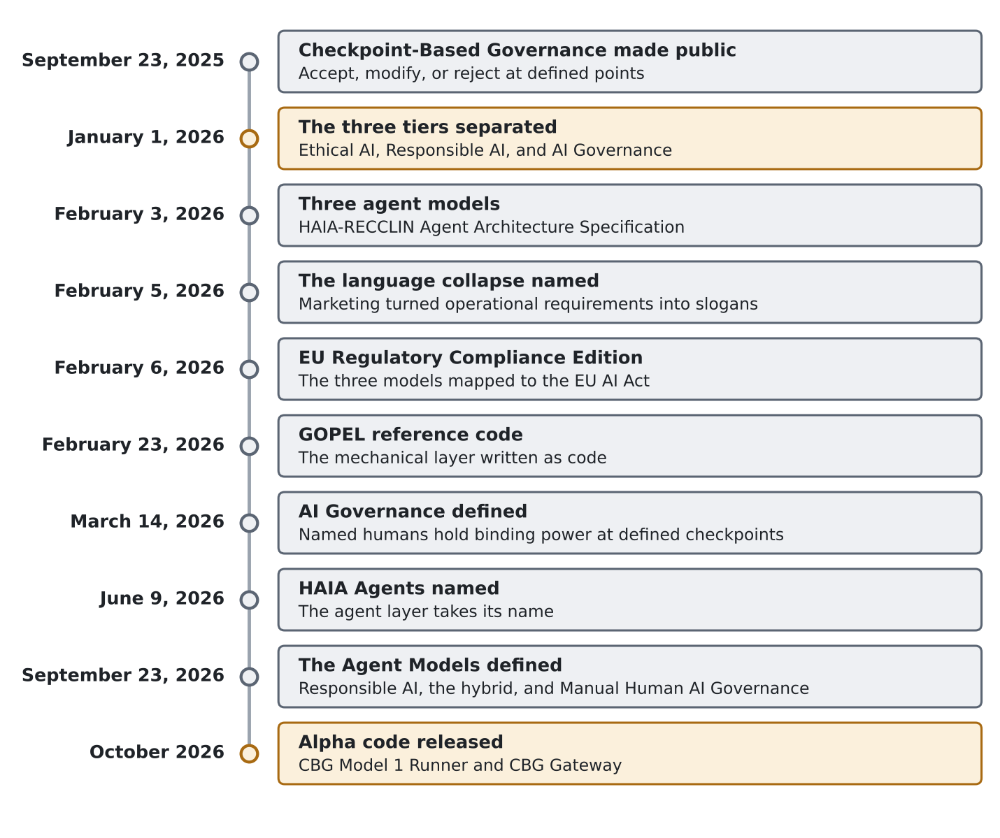
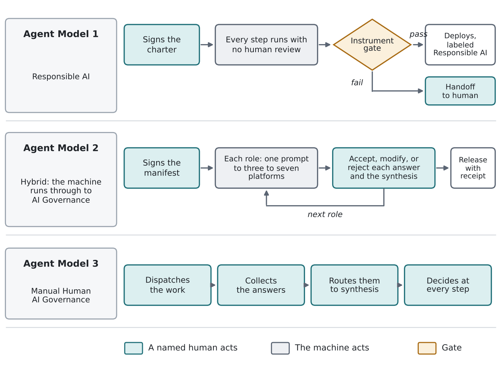
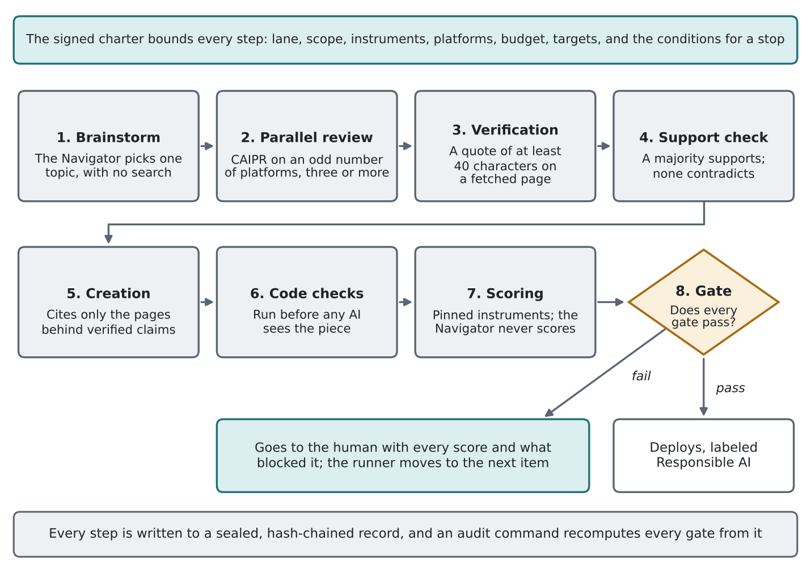
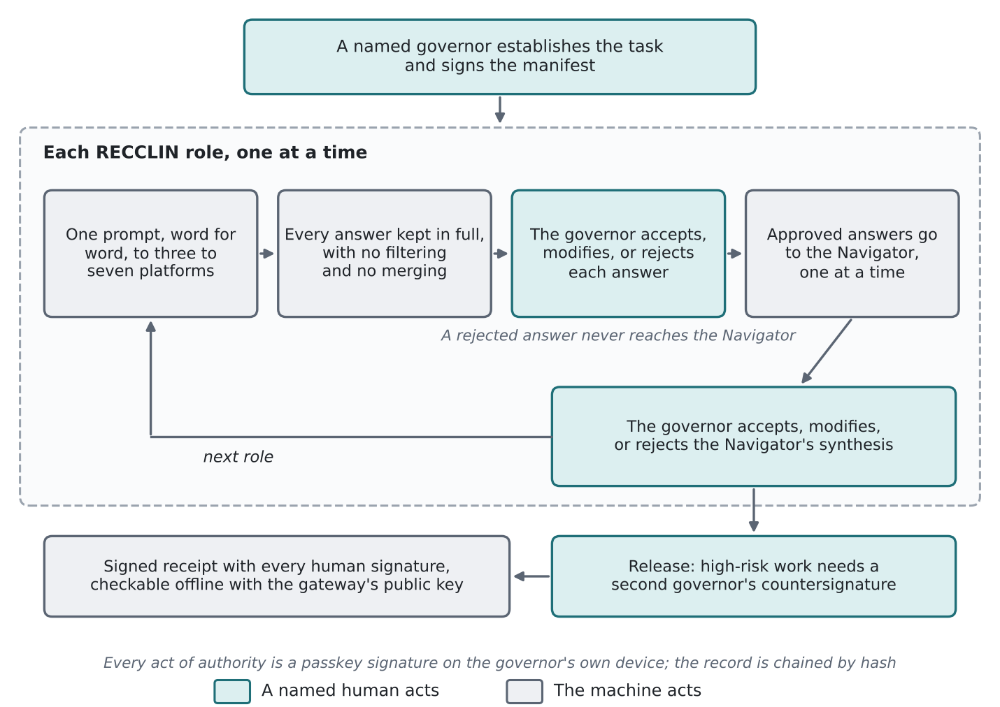

# HAIA Agents: From the Definition Problem to Running Code

## Agent Model 1 and Agent Model 2 in Alpha, and Agent Model 3 Revisited

Basil C. Puglisi, MPA | basilpuglisi.com

First published February 3, 2026, as the HAIA-RECCLIN Agent Architecture Specification. Rebuilt October 2026.

---

## Abstract

The year 2026 opened on a definition problem. The field used one vocabulary for automation and for human-centered control, so a system that only watched itself could be sold as governed, and a person who only watched a screen could be counted as a governor. On January 1, 2026, the author separated Ethical AI, Responsible AI, and AI Governance as distinct layers. On February 3, 2026, the original paper turned that separation into three agent models that differ by where the human stands: an agent that runs the whole pipeline, an agent that stops for a human at every functional role, and no agent at all. On February 23, 2026, a non-cognitive enforcement layer, which the author calls GOPEL, showed that the mechanical layer could be written as code that performs no cognitive work, and on March 14, 2026, the definition of AI Governance named who answers. This rebuild carries that path forward to working software. It introduces the Alpha release of code for Agent Model 1, which is Responsible AI written as code that checks the machine with other machines and passes nothing without a gate, and for Agent Model 2, the hybrid in which the machine runs through to AI Governance at a signed human checkpoint after every role. It then revisits Agent Model 3, Manual Human AI Governance, which remains the default in use and which produced both releases. Both releases are published with the checks they pass in the author's HAIA repository on GitHub. Neither is deployed, and in the build record neither has yet called a live AI provider.

---

## 1. The Definition Problem That Opened 2026

The problem was never a shortage of principles. By the end of 2025 the field had ethics guidelines, risk frameworks, management standards, and a growing list of terms for keeping people involved, and those terms ran together. "We keep arguing about AI safety while failing to define governance itself," the January 1 article opened, and it proposed that the failure was linguistic before it was operational (Puglisi, 2026n).

That article split the field into three layers, each with its own question. "Ethical AI is the articulation of values." "Responsible AI translates values into machine behavior." "AI Governance assigns decision rights, escalation paths, override authority, and consequence ownership" (Puglisi, 2026n). The split mattered because the middle layer had absorbed the third. Constitutional training, alignment research, guardrails, and automated monitoring all shape a system before or during its output, and none of them names a person who answers for that output. The article held the line in one sentence: "Responsible AI becomes governance only when a named human has veto authority for high-impact outputs" (Puglisi, 2026n).

The same article supplied the image the agent models later built on. A factory can carry ethical design into every step of its line, and "It is still a factory." A handmade product differs because "The handmade product has a human hand on the output" (Puglisi, 2026n). The article then took the strongest version of automation seriously. A panel of independent AI systems checking each other, which it called a Multi-AI Supreme Court, "might represent the best achievable version of Responsible AI at scale," yet the article's verdict followed at once: "It is still not governance." The panel can converge on a confident error when its members share upstream bias, so a better machine check still leaves no one who answers (Puglisi, 2026n). The answer it offered was a hybrid rather than a choice between the two: "the hybrid handles volume; the human handles governance" (Puglisi, 2026n).

On February 5, 2026, the author named the mechanism behind the confusion. "Most AI titles and terms being used right now are dead wrong," the article began, because marketing had turned operational requirements into slogans, and "Clarity of language is a prerequisite for accountability" (Puglisi, 2026g). Its test cases were the two phrases most often offered as proof of control. Human-in-the-loop, as practiced, often left the human "technically present but operationally decorative," and the article drew the difference as "the difference between a human who participates and a human who decides" (Puglisi, 2026g). Human-centric design received the same treatment: "A system designed around human needs is not the same as a system governed by human authority" (Puglisi, 2026g).

That is the term problem this paper answers. Automation and human-centered control were described with the same words, so an organization could build excellent automation, call it governance, and believe it had a control it never built. The agent models exist to keep those two things apart in the architecture, where a label cannot blur them.

---

## 2. Where the Path Began: Checkpoint-Based Governance

The path started with Checkpoint-Based Governance, made public on September 23, 2025, as an implementation framework still in drafting. It described itself as "a protocol-driven framework for structuring human-AI collaboration" and already named the failure the later models would have to watch for, listing among its drift signals that "Increasing approval rates may indicate automation bias" (Puglisi, 2025a). The current framework page carries the same idea in its title, "Presence Is Not Authority," and places a named human "at defined points in the work" with authority to accept, modify, or reject what the AI produced (Puglisi, 2026d).

Checkpoint-Based Governance does not claim to have invented human oversight or accountability. It applies existing oversight research and policy to AI work and asks that the human checkpoint leave evidence: who decided, on what, and why. Every checkpoint closes on accept, modify, or reject. That narrow structure is what made the agent models possible, because once a checkpoint is defined, the remaining question is mechanical: where in the work the checkpoints sit, and what the machine is allowed to do between them.

Figure 1 traces the path from that starting point to the Alpha release.

*Figure 1. The path from Checkpoint-Based Governance to running code, September 2025 to October 2026*

---

## 3. The First Answer: Three Agent Models

The original paper, published February 3, 2026, as the HAIA-RECCLIN Agent Architecture Specification, answered that question with three models that differ by checkpoint density (Puglisi, 2026i). It divided the work into seven functional roles (Researcher, Editor, Coder, Calculator, Liaison, Ideator, and Navigator), a role-based practice which the author calls HAIA-RECCLIN, and it placed an agent between the AI layer and the human layer to move the work.

The agent's job was deliberately small. The specification called it "a traffic controller. It performs zero cognitive work," and described it as "a pipe with a logbook" (Puglisi, 2026i). Three models followed from where that pipe stops:

- **Model 1.** "The agent runs the full RECCLIN pipeline without stopping," and the human "exercises CBG authority once at the final output" (Puglisi, 2026i).
- **Model 2.** The agent "pauses after each RECCLIN functional role, presenting three-platform output plus dissent documentation to the human," and the human approves before the next role begins, so a task that passes through five roles meets five checkpoints (Puglisi, 2026i).
- **Model 3.** "No agent. The human performs all orchestration" (Puglisi, 2026i).

Every transaction was to leave six record types: Request, Dispatch, Response, Navigation, Arbitration, and Decision. The specification was candid about its status, and its own table marked Models 1 and 2 as requiring an agent build and Model 3 as ready for use (Puglisi, 2026i).

The names already carried the tiers. The specification called Model 1 "Agent Responsible AI," Model 2 "Agent AI Governance," and Model 3 "Manual Human AI Governance," and it gave the reason for the first: "Model 1 is explicitly named Responsible AI because, at factory quality, the agent handles upstream shaping and the human reviews the final output" (Puglisi, 2026i).

The same paper settled the hardest question in the set, which was whether the human review at the end of Model 1 counted as governance. It did not. "The natural checkpoint at the Model 1 endpoint is an informal safety valve, not a formal governance control" (Puglisi, 2026i). The formal control it named was the automation bias trigger in Checkpoint-Based Governance, and "Persistent threshold violations trigger escalation from Model 1 to Model 2" (Puglisi, 2026i). Three days later, the EU Regulatory Compliance Edition mapped the same three models against the EU AI Act and attached a quality label to each: Model 1 as "Responsible AI (Factory Quality)," Model 2 as "AI Governance (Handmade Quality)," and Model 3 as "AI Governance (Evidence Standard)" (Puglisi, 2026j).

That ruling is where the definition problem and the architecture met. A person who receives a finished product at the end of an automated line, with no view of how it was made, is reviewing output. The January article had already called that condition "governing blind" (Puglisi, 2026n). Model 1 was Responsible AI from the start; the February documents simply had not yet removed the person who stood at its end.

---

## 4. Evidence the Mechanics Could Be Built: GOPEL

The specifications described an agent that did not exist. On February 23, 2026, the author published reference code for its mechanical layer, a non-cognitive enforcement layer that dispatches, collects, routes, logs, pauses, hashes, and reports, which the author calls GOPEL, the Governance Orchestrator Policy Enforcement Layer (Puglisi, 2026f). The design claim was that "The agent performs zero cognitive work," and that an agent unable to evaluate content cannot be steered through content (Puglisi, 2026f).

Seven AI platforms (Claude, ChatGPT, Gemini, Grok, Kimi, DeepSeek, and MiniMax) were used to attack the code before publication, and the article reported the critical and high-severity findings as fixed (Puglisi, 2026f).

The article was equally plain about the limits. The code ran on mock adapters, not live provider connections, and "It isn't deployment-ready software" (Puglisi, 2026f). GOPEL showed that the mechanics could be written, though it did not yet carry an agent model end to end.

---

## 5. Closing the Definition: Who Answers

On March 14, 2026, the author published the formal definition the January article had called for. In its full form: "AI Governance is the system of decision authority, accountability structures, and oversight mechanisms through which named humans hold binding power to approve, modify, or halt AI outputs at defined checkpoints, with accountability that survives audit through moral, employment, civil, and criminal channels" (Puglisi, 2026a). The contrast with Responsible AI was stated in two short lines: "Responsible AI shapes the machine." "AI Governance answers for it" (Puglisi, 2026a).

The definition kept moving as the work did. In June 2026, the second accountability channel changed from employment to professional, so that accountability reaches contractors, regulators, board members, and licensed professionals that an employment frame misses; the framework's public pages now name "moral, professional, civil, and criminal" (Puglisi, 2026b). On June 9, 2026, the agent layer took the name HAIA Agents. On September 23, 2026, the three models received the definitions this paper builds on, recorded in the author's words: "Agent Model 1 was defined as Responsible AI a version of automation, AI Agents machine checks machine all code. Agent Model 2 is hybrid of Machine runs through to AI Governance (presumed use of a tool like GOPEL), then Agent Model 3 is Manual Human AI Governance."

Those definitions closed the gap the February documents left open. Agent Model 1 is Responsible AI throughout, with no human review counted as governance. Agent Model 2 is the hybrid: the machine carries the work, and AI Governance happens at each checkpoint where a named human signs. Agent Model 3 is AI Governance with no agent at all, and Figure 2 shows where the named human stands in each model. The October build began from that text.

*Figure 2. Where the named human stands in each of the three Agent Models*

---

## 6. Agent Model 1 in Alpha: Responsible AI Written as Code

### 6.1 The requirement

The author set the requirement on October 8, 2026: "What can we reasonably do for full automation, while being able to maintain the Multi-AI methodology we use minus the human." The Navigator, the role that synthesizes and decides, would make the judgment calls; at least three other AI platforms would do the review; and the record of outputs, syntheses, and the Navigator's judgment would be kept "so the process can be reviewed and audited by a human later." Two further requirements shaped everything after. The first: "there must be a gate to qualify if something gets published or acted on." The second was what happens when a piece cannot reach that gate: it goes to the human, and the agent moves on to the next project. In the author's terms, forcing a failed piece through the gate is a failure, and so is leaving the human out of a process that keeps failing.

The release is a single Python program, which the author calls the CBG Model 1 Runner. It runs one lane of work, such as a daily column, a stream of social posts, or images, with no human review of any output before it goes out. Every output carries the label "Responsible AI: automated, machine checks machine, no human review of this output."

### 6.2 What the human signs

The human's authority sits in a charter. A named human signs it with a passphrase-protected key on a device the runner does not control, and the charter fixes the lane, its scope, the instruments that score it, the AI platforms and the providers file behind them, the budget, the targets, and the conditions for a stop. The runner holds only the public key. It cannot change the charter, and it cannot write a stop or a resume. A signed stop freezes it before the next stage, and an integrity failure freezes it until the human signs a resume dated after the freeze.

The charter does not review any output, and the runner never treats it as review. No named human is bound to an individual piece, which is why each piece is labeled Responsible AI.

### 6.3 The loop

Each item runs through the same sequence, shown in Figure 3, and the order is the point.

1. **Brainstorm.** The Navigator, an AI platform held out of every review, picks one topic inside the signed scope. It has no search at this stage and sends nothing but the topic, and the topic is sealed in the record before anything is dispatched. Silence is always allowed.
2. **Parallel review.** The topic goes word for word the same to an odd number of AI platforms, three or more, at once, a practice which the author calls CAIPR, Cross AI Platform Review. Each platform receives the RECCLIN Governance Mode Session Prompt, which asks every return to show its sources, its conflicts, and its fact-to-tactic-to-KPI reasoning.
3. **Verification.** Only after the returns are in does the Navigator get search, and the runner runs every search and page fetch itself, so each query and page is on the record. A claim counts as verified only when the Navigator named it from a return and a quote of at least 40 characters appears on a page the runner fetched.
4. **Support check.** A quote on a page does not prove the page supports the claim, so the verified claims, each with the text around its quote, go back to the review platforms. A claim survives only when a majority say the page supports it and none says it contradicts it. Every piece must rest on at least one such claim.
5. **Creation.** The Navigator builds the piece, names the claims it rests on, and may cite only the pages behind those claims.
6. **Code checks.** Before any AI sees the piece, code checks the disclosure line, length limits, placeholders, forbidden terms, links without custody, image type, size, and wholeness, and any text in the piece that imitates a scorer's output or gives an AI instructions.
7. **Scoring.** The piece and the full text of the lane's instrument, pinned by its SHA-256 hash, go word for word the same to the review platforms. The Navigator never scores its own work, and every review returns to it in full for revision.
8. **Gate or handoff.** The piece deploys only when every gate passes. Otherwise it goes to the human with every platform's scores and what blocked it, and the runner moves to the next item without waiting or retrying.

*Figure 3. The Agent Model 1 loop, from brainstorm to the gate or the handoff*

### 6.4 The gates

The gates come from the author's own instruments, each pinned by hash in the charter. A social post must reach 24 of 30 on the post-scoring instrument, which the author calls HAIA-SMART Copy, where "A score of 24 or higher passes" (Puglisi, 2026m). An image must reach "Strengthens (12+)" of 15, and a carousel "Strengthens (16+)" of 20, on the companion instrument for visuals, which the author calls HAIA-SMART Creative (Puglisi, 2026k). An article must reach 24 of 30 on the article evaluator, which the author calls HAIA-CORE, and that evaluator sets "Pass at 24 and above" (Puglisi, 2026e). A gate passes only when a majority of the platforms dispatched score the piece at or above the line and none raises a hard stop. Hard stops come from the instruments themselves. On HAIA-CORE, "Any pillar scoring 1 or 2 flags that pillar on the output and holds the run for a human ruling before the article proceeds," and the instrument also holds the run when "a source does not support its claim" (Puglisi, 2026e). On HAIA-SMART Creative, a platform compatibility flag holds the piece the same way. A majority in the Rework band ends the item at once. There is no instrument for video, so the runner makes no video.

### 6.5 Flags

Agreement is not treated as proof. When every review platform reports no conflicts, the runner raises a convergence flag and answers it the way CAIPR names, by adding two more platforms or by verification outside the AI ecosystem; on the framework's page, "unanimous agreement on a claim that matters triggers verification outside the pool rather than confidence inside it" (Puglisi, 2026l). The runner also flags returns that all cite the same sources, which only a claim verified on a different site answers, and returns that carry text addressed to an AI as instructions, whose claims cannot be used. When every scorer gives the same passing total with no dissent and no reserve platform remains to add, the flag stands and the piece goes to the human.

### 6.6 Bounds

The bounds came from the author's earlier automation run on a single platform, Grok Bot, whose recorded failures included checks claimed but never done, posts to the wrong target, silent runs, a double post, and repeated sign-in attempts against blocked accounts. The author's rule for the new code was direct: "Agents should view their work load and resource bound and for efficiency not loop or cross bounds outside of the scope." The charter therefore caps calls, tokens, review rounds, searches, page fetches, and time, per item and per run. A failed deployment, a sign-in problem, a target the deploy step does not confirm, or a live page that does not show the piece is handed to the human and ends the run, so the runner never returns to a target that refused it. A handoff that reaches no one freezes the runner, and only one runner may hold a record at a time.

### 6.7 The record

Every step is written to an append-only record, chained by hash and sealed with the runner's own key, so an entry cannot be moved, relabeled, or cut from the middle without that key. Each run signs the head of the record and writes it outside the record, and each deployment carries a signed receipt. An audit command recomputes every gate and every support check from the stored returns, confirms that no search came before the review returns, that the Navigator never scored, that every deployment matches a passing gate on the same piece, and that nothing went out while the runner was stopped. A copy of the signed heads and receipts kept off the host lets the audit catch records cut from the end. The runner also accepts external integrity watches before every item and every deployment, which is where a GOPEL integrity check attaches later.

### 6.8 Design rules drawn from Russell

The author asked that Stuart Russell's principles guide the Navigator as the agent. Russell (2019) offers three principles: "The machine's only objective is to maximize the realization of human preferences," "The machine is initially uncertain about what those preferences are," and "The ultimate source of information about human preferences is human behavior" (p. 173). Russell offers them as guidance for the people who design machines, and the runner takes them that way, as design rules for its builder rather than a claim to have built his program of provably beneficial machines.

The first rule became the charter: the Navigator holds no goal of its own and cannot change what the human signed. The second became late commitment: the Navigator chooses a topic without knowing where it will land, commits to an end result only after the review and verification, and may stay silent. The third is narrower in code than in Russell. The runner learns nothing from AI output or from its own deployments, and treats the named human's signed acts as the only evidence of what the human wants.

### 6.9 How it was built and tested

The code was written with Claude in the Coder role under the author's direction and rulings, then attacked by other AI platforms. Six reviews of the second build were returned on October 9, 2026, from Gemini, Perplexity, Grok, Mistral, MiniMax, and ChatGPT, although the return from MiniMax noted that the code file was not attached. Several reviews reported defects that reproduced when tested, including a piece that could carry a forged scoring record, a hard stop missed when a scorer reworded it, and an unsigned file that could block a real stop. Each finding was checked against the code, and the confirmed ones were fixed in the third build and kept as permanent tests. A separate internal attack on the third build found further gaps in how text was compared and how acts were ordered, and those were fixed as well. The Alpha passes 379 internal checks and an offline run with canned platforms, search, and pages. It has not called a live AI provider or a live search service.

The reviews also carried dissent that this paper keeps. Five of the six said the original Russell mapping claimed more mechanism than the code carries, which is why Section 6.8 now presents design rules. One review argued that the Responsible AI label asserts more than independent scorers can prove. Several noted that scoring platforms trained on similar data can share a blind spot, and that the instruments were written for a human author whose approval steps Agent Model 1 replaces with the charter and the gate.

---

## 7. Agent Model 2 in Alpha: the Hybrid That Runs Through to AI Governance

### 7.1 The requirement

On October 7, 2026, the author asked for "a CBG Code that sits between AI Use and Final Outputs," software "that acts as the user interface to API access for AI platforms that makes sure CBG is being followed." The scope, set October 8, 2026, called for an interface that "could be deployed using API across 3 to 7 AI platforms to dispatch work and validated that they work in a manner consistent with CBG." The requirements were specific: the Navigator acts as the main connection, the interface sends requests out and returns independent answers with "no filter no Synthesize," it shows the full RECCLIN outputs, and it sends them to the Navigator "one at a time as read and approved." Because GOPEL does not run as a service, the interface had to work on its own.

The release is a single Python program, which the author calls the CBG Gateway. It is the only program that holds the AI platform keys, so agents and automations cannot reach the platforms except through it.

### 7.2 Checkpoints per role

An agent proposes a task. A named governor establishes it, with the authority to rewrite its scope, criteria, and constraints, raise its risk class, narrow where its results may go, choose the Navigator and the platforms for each role, and sign. The gateway then runs only what the signed manifest names, one RECCLIN role at a time, as Figure 4 shows.

At each role, one prompt goes word for word the same to three to seven AI platforms at once, and every answer is kept in full as it arrived, with no filtering and no merging. The governor reads each platform's complete answer and accepts, modifies, or rejects it. Each answer the governor lets through goes to the Navigator, a separate platform held out of the dispatch, one at a time and in the order approved. An answer the governor rejected never reaches the Navigator. When every answer is decided, the Navigator's synthesis becomes its own checkpoint, and the governor accepts, modifies, or rejects it before the next role starts. No role advances, and no result is released, without a verified signature from the governor named in the signed manifest.

*Figure 4. Agent Model 2 checkpoints, from the signed manifest to the signed receipt*

That is the hybrid in practice. The machine carries the dispatch, the collection, the routing, and the record at machine speed, which is the labor Agent Model 3 performs by hand. Each checkpoint is AI Governance, because a named human decides with the complete answers in view and signs for the decision.

### 7.3 Signatures, records, and receipts

Every act of authority requires a passkey signature made on the governor's own device after a fingerprint, face check, or device PIN, and the gateway holds only public keys, so no AI and no agent can approve anything. The gateway maps its rules to Checkpoint-Based Governance: authority before the work, a signed stop or a restart during it, accept, modify, or reject after it, and no deferred decision before the next role or before release. A high-risk task names a second governor, who must countersign the final text. Two people stand behind every new passkey after the first, so no single operator can enroll a governor alone.

The record is chained by hash, every AI-side entry carries the gateway's seal, and the gateway signs the head of its record after every human act and every release and sends it to storage outside its own host. Every release writes a receipt that anyone holding the gateway's public key can check offline, including every human signature on the authorization, every decision, and every countersignature.

### 7.4 What the record shows about governing

The gateway scores nothing, because scoring is judgment. It keeps the evidence a governed process leaves: who decided each answer and synthesis, how fast, how much of the AI text the governor changed, how many answers the governor kept from the Navigator, and how often the governor overrode the Navigator. The automation bias question that Checkpoint-Based Governance raised in September 2025 becomes measurable here. The gateway reports each governor's accept, modify, and reject rates and review times, and enforces no threshold, because the thresholds remain proposed and untested.

### 7.5 How it was built and tested

The gateway was written with Claude in the Coder role under the author's direction, and reviews run on 10 AI platforms returned 17 critiques across its first eight builds between October 7 and October 8, 2026: MiniMax, Kimi, Grok, Gemini, ChatGPT, Perplexity, Mistral, DeepSeek, Meta AI, and Claude Fable run outside the project. Confirmed findings were fixed build by build and kept as permanent tests. The Alpha passes 386 internal checks and 22 checks through its own review screens in a headless browser with a simulated passkey. It has run only against canned platforms.

---

## 8. Agent Model 3 Revisited: Manual Human AI Governance

Agent Model 3 has no agent. The human dispatches the work, collects the answers, routes them to the synthesis platform, decides at every step, and moves to the next. The original paper described the cost plainly, and the cost is why automation was ever pursued; it also described the evidence, and the evidence is why Agent Model 3 remains the standard the other two are measured against.

The original paper put the logging case in one line: "The act of working is the act of logging" (Puglisi, 2026i). Each platform keeps its own conversation history as the work happens, so the human's obligation at the end of a project is to collect and keep those histories, and the paper called it "a retention task, not a documentation task" (Puglisi, 2026i). Because no orchestration layer touches that evidence, it is the most faithful record of what was asked, what came back, and what the human decided.

Two things changed since February. The first is documentation. The structured record that turns a manual session into an auditable account of what happened, who decided, and what the evidence was, which the author calls CARCS, was published on April 23, 2026, and its page states that "Model 3, which CARCS was built to serve, runs with no agent and no automated infrastructure" (Puglisi, 2026c). A CARCS record from Agent Model 3 work declares itself Attestation Grade rather than Hash Verified, and the page holds that the two "are not equivalent evidentiary states" (Puglisi, 2026c).

The second change is that Agent Model 3 built the Alpha. Every review round on both programs was dispatched by the author to the review platforms and returned by hand, with each return saved and logged on receipt. The author set every requirement and ruled on every question that changed what an agent does, while the technical fixes were settled in the build and tested before they entered the code. The release of Agent Model 1 and Agent Model 2 is itself an Agent Model 3 record. The framework's public page still describes Agent Model 3 as "the default in use today" that "produced every published case study" (Puglisi, 2026h), and that remains true. The Alpha does not retire it. It gives organizations two places to stand short of it.

Model selection remains a checkpoint decision. The original paper made the choice of model a decision recorded with its risk rationale, and nothing in the Alpha changes that (Puglisi, 2026i).

---

## 9. The Three Agent Models Side by Side

| | Agent Model 1 | Agent Model 2 | Agent Model 3 |
|---|---|---|---|
| **Designation** | Responsible AI | Hybrid: the machine runs through to AI Governance | Manual Human AI Governance |
| **Where the human stands** | Signs the charter and any stop or resume; reviews no output | Signs the manifest, every answer decision, and every synthesis; a second governor countersigns high-risk work | Performs and decides every step |
| **What the machine does** | Brainstorms, reviews in parallel, verifies, creates, scores, and deploys inside the charter | Dispatches, collects, routes, records, and refuses what the rules refuse | Nothing beyond each platform's own answer |
| **What stops a bad output** | The instrument gates, hard stops, flags, and handoff to the human | The governor's reject at the checkpoint | The human, directly |
| **Fits** | Low to moderate risk, routine lanes | High-risk decisions | Highest-consequence and novel work, framework development |
| **Status, October 2026** | Alpha code, not deployed | Alpha code, not deployed | In use; produced the published corpus and the Alpha |

---

## 10. What the Alpha Does Not Claim

Alpha means the code runs, passes its own checks, and survived the reviews described above. It does not mean deployment readiness.

Neither program has been deployed, and neither has called a live AI provider in the build record. Neither has had a professional security review. Both depend on the machine that runs them: whoever controls the host and the signing keys can still rewrite records, which is why both send signed copies of their record heads to storage the host cannot reach, and why both list deployment requirements that the code cannot enforce on its own.

The judgment inside Agent Model 1 is AI judgment. Independent scorers and code checks lower the risk that a weak or wrong piece goes out, and they do not remove it, because the platforms are not calibrated to each other and may share blind spots. Agent Model 1 also keeps a sealed ledger rather than a CARCS record, so its record is the machine's own account of what it did, produced and checked by code, rather than a governed account of a session that a named human approved.

The gateway in Agent Model 2 establishes what was signed, not what was read. A passkey signature shows that an enrolled person approved after the device checked them; it cannot show that the person understood the answer. The gateway governs only the AI use that passes through it, and someone can still paste a prompt into a chat window outside it.

---

## 11. Where the Code Lives

Both Alpha releases are published on [GitHub](https://github.com/basilpuglisi/HAIA) in the author's HAIA repository, the same repository that holds the GOPEL reference code, so the agent models and the enforcement layer that HAIA Agents names sit side by side. Each program sits beside the checks this paper reports, and those checks run offline against canned platforms, search results, and pages, with no live AI provider or account. A reader can rerun the 379 checks for Agent Model 1 and the 386 internal checks and 22 browser checks for Agent Model 2 before connecting anything, and the header of each program states what it needs, how to run it, and what it cannot do.

The code is offered for reading, testing, and critique under the license that closes this paper. It is Alpha, and Section 10 states what that means: no deployment, no live provider in the build record, and no professional security review. Anyone who runs either program against live services takes on the conditions each program lists, including keeping signing keys and copies of the record where the host cannot reach them.

---

## 12. Conclusion

The year began with a vocabulary that let automation pass for governance and let presence pass for authority. The answer was never to choose between machines and people. It was to say, in the architecture, which one answers. Agent Model 1 now shows what the best Responsible AI the author can build looks like in code: a machine that picks its topic without knowing the end, sends it to independent platforms, verifies what they claim, writes, submits its work to scorers it cannot influence, and stops at a gate it cannot move. Agent Model 2 shows the hybrid the January article described, with the machine handling volume and a named human signing every decision that matters. Agent Model 3 remains where the evidence is cleanest, and it is where both programs were built.

The definition problem of January 2026 was a problem of words. The Alpha release makes the same distinction in code, where each output carries either a Responsible AI label or a human signature.

---

## References

Puglisi, B. C. (2025a, September 23). *Checkpoint-Based Governance: An implementation framework for accountable human-AI collaboration (v2 drafting)*. basilpuglisi.com. https://basilpuglisi.com/checkpoint-based-governance-an-implementation-framework-for-accountable-human-ai-collaboration-v2-drafting/

- Latest update: Puglisi, B. C. (2026d, September 11). *Checkpoint-Based Governance: Presence is not authority*. basilpuglisi.com. https://basilpuglisi.com/cbg/
- Bradley, A. (2025). *Global AI governance: Five key frameworks explained*. Bradley Law Insights. https://www.bradley.com/insights/publications/2025/08/global-ai-governance-five-key-frameworks-explained
- Congruity 360. (2025, June 23). *Building your AI data governance framework*. https://www.congruity360.com/blog/building-your-ai-data-governance-framework
- European Parliament and Council. (2024). *Regulation (EU) 2024/1689 (Artificial Intelligence Act)*. Official Journal of the European Union. https://eur-lex.europa.eu/eli/reg/2024/1689/oj
- ISACA. (2025, February 3). *COBIT: A practical guide for AI governance*. https://www.isaca.org/resources/news-and-trends/isaca-now-blog/2025/cobit-a-practical-guide-for-ai-governance
- International Telecommunication Union. (2025). *The annual AI governance report 2025: Steering the future of AI*. ITU Publications. https://www.itu.int/epublications/publication/the-annual-ai-governance-report-2025-steering-the-future-of-ai
- Lu, J., Liu, A., Dong, F., Gu, F., Gama, J., & Zhang, G. (2019). Learning under concept drift: A review. *IEEE Transactions on Knowledge and Data Engineering, 31*(12), 2346-2363. https://doi.org/10.1109/TKDE.2018.2876857
- Lumenalta. (2025, March 3). *AI governance checklist (Updated 2025)*. https://lumenalta.com/insights/ai-governance-checklist-updated-2025
- McKinsey & Company. (2025). *Superagency in the workplace: Empowering people to unlock AI's full potential at work*. https://www.mckinsey.com/capabilities/mckinsey-digital/our-insights/superagency-in-the-workplace-empowering-people-to-unlock-ais-full-potential-at-work
- National Institute of Standards and Technology. (2023). *Artificial Intelligence Risk Management Framework (AI RMF 1.0)*. U.S. Department of Commerce. https://nvlpubs.nist.gov/nistpubs/ai/NIST.AI.100-1.pdf
- Nexastack. (2025). *Agent governance at scale*. https://www.nexastack.ai/blog/agent-governance-at-scale
- OECD. (2025). *Steering AI's future: Strategies for anticipatory governance*. https://www.oecd.org/content/dam/oecd/en/publications/reports/2025/02/steering-ai-s-future_70e4a856/5480ff0a-en.pdf
- Parasuraman, R., & Manzey, D. H. (2010). Complacency and bias in human use of automation: An attentional integration. *Human Factors, 52*(3), 381-410. https://doi.org/10.1177/0018720810376055
- Precisely. (2025, August 11). *AI governance frameworks: Cutting through the chaos*. https://www.precisely.com/datagovernance/opening-the-black-box-building-transparent-ai-governance-frameworks
- Splunk. (2025, February 25). *AI governance in 2025: A full perspective*. https://www.splunk.com/en_us/blog/learn/ai-governance.html
- Stanford Institute for Human-Centered Artificial Intelligence. (2024). *Artificial Intelligence Index Report 2024*. Stanford University. https://aiindex.stanford.edu/report/
- Strobes Security. (2025, July 1). *AI governance framework for security leaders*. https://strobes.co/blog/ai-governance-framework-for-security-leaders
- Superblocks. (2025, July 31). *What is AI model governance?* https://www.superblocks.com/blog/ai-model-governance
- Visa. (2025). *Visa introduces Trusted Agent Protocol: An ecosystem-led framework for AI commerce*. https://investor.visa.com/news/news-details/2025/Visa-Introduces-Trusted-Agent-Protocol

Puglisi, B. C. (2025b, December 6). *HAIA-CORE: Evaluate your content before the algorithm does*. Medium. https://medium.com/@basilpuglisi/haia-core-evaluate-your-content-before-the-algorithm-does-812e0ebbba04

- Latest update: Puglisi, B. C. (2026e, September 12). *CORE: Content Optimization Reader Evaluation, and how to score an article before anyone reads it*. basilpuglisi.com. https://basilpuglisi.com/haia-core-content-optimization-reader-evaluation/
- Google Search Central. (2026, May 15; updated 2026, July 10). *Optimizing your website for generative AI features on Google Search*. https://developers.google.com/search/docs/fundamentals/ai-optimization-guide
- Liang, W., Yuksekgonul, M., Mao, Y., Wu, E., & Zou, J. (2023). GPT detectors are biased against non-native English writers. *Patterns, 4*(7), 100779. https://doi.org/10.1016/j.patter.2023.100779
- Weber-Wulff, D., Anohina-Naumeca, A., Bjelobaba, S., Foltýnek, T., Guerrero-Dib, J., Popoola, O., Šigut, P., & Waddington, L. (2023). Testing of detection tools for AI-generated text. *International Journal for Educational Integrity, 19*, Article 26. https://doi.org/10.1007/s40979-023-00146-z

Puglisi, B. C. (2026a, March 14). *AI Governance has no formal definition. Here is one*. basilpuglisi.com. https://basilpuglisi.com/ai-governance-has-no-formal-definition-here-is-one/

- Latest update: Puglisi, B. C. (2026b, September 15). *Artificial intelligence: Technology, capability, governance, and human accountability*. basilpuglisi.com. https://basilpuglisi.com/ai-artificial-intelligence/
- Batool, A., Zowghi, D., & Bano, M. (2025). AI governance: A systematic literature review. *AI and Ethics, 5*, 3265-3279. https://doi.org/10.1007/s43681-024-00653-w
- Companies committed to responsible AI: From principles towards implementation and regulation? (2021). *Philosophy & Technology*. PMC 8492454.
- Council of Europe. (2026, January 28). *Armenia signs the Framework Convention on Artificial Intelligence*. https://www.coe.int/en/web/artificial-intelligence/-/armenia-signs-the-council-of-europe-s-framework-convention-on-artificial-intelligence-1
- European Union. (2024). *Artificial Intelligence Act, Article 14: Human oversight*. https://artificialintelligenceact.eu/article/14/
- Floridi, L., & Cowan, S. (2025). Operationalizing accountability in AI governance: From principles to procedures. *AI and Ethics, 5*(2). https://doi.org/10.1007/s43681-025-00438-2
- Goffi, E. R. (2022). Respecting cultural diversity in ethics applied to AI: A new approach for multicultural governance. *Revista Misión Jurídica*.
- International Organization for Standardization. (2021). *ISO 37000:2021 Governance of organizations*. https://www.iso.org/standard/65034.html
- International Organization for Standardization. (2022). *ISO/IEC 38507:2022 Governance implications of the use of AI by organizations*. https://www.iso.org/standard/56641.html
- International Organization for Standardization. (2023). *ISO/IEC 42001:2023 AI management systems*. https://www.iso.org/standard/42001
- Jobin, A., Ienca, M., & Vayena, E. (2019). The global landscape of AI ethics guidelines. *Nature Machine Intelligence, 1*, 389-399. https://doi.org/10.1038/s42256-019-0088-2
- Maas, M. M. (2025). *Architectures of global AI governance: From technological change to human choice*. Oxford Academic. https://doi.org/10.1093/9780191988455.003.0001
- National Institute of Standards and Technology. (2023). *AI Risk Management Framework (AI RMF 1.0)*. https://nvlpubs.nist.gov/nistpubs/ai/nist.ai.100-1.pdf
- National Institute of Standards and Technology. (2024). *Generative AI Profile (NIST AI 600-1)*. https://nvlpubs.nist.gov/nistpubs/ai/NIST.AI.600-1.pdf
- OECD. (2019). *Recommendation of the Council on Artificial Intelligence*. https://oecd.ai/en/ai-principles
- OECD. (2024). *Recommendation of the Council on Artificial Intelligence* (OECD/LEGAL/0449, amended 2024). https://oecd.ai/en/ai-principles
- Stanford Institute for Human-Centered Artificial Intelligence. (2026). *AI Index Report 2026: Technical performance*. https://hai.stanford.edu/ai-index/2026-ai-index-report/technical-performance
- Stix, C. (2022). Artificial intelligence by any other name: A brief history of the conceptualization of "trustworthy artificial intelligence." *Discover Artificial Intelligence, 2*(26). https://doi.org/10.1007/s44163-022-00041-5
- UNESCO. (2021). *Recommendation on the Ethics of Artificial Intelligence*. https://www.unesco.org/en/legal-affairs/recommendation-ethics-artificial-intelligence
- Waldrop, M. (1987). A question of responsibility. *AI Magazine*.

Puglisi, B. C. (2026c, April 23). *CARCS: Compliance accountability record & case study*. basilpuglisi.com. https://basilpuglisi.com/haia-carcs-compliance-accountability-record-case-study/

- Akin Gump Strauss Hauer & Feld LLP. (2026, February). *SDNY rules communications with a public generative AI platform are not protected by attorney-client privilege or work product doctrine*. akingump.com
- Debevoise & Plimpton LLP. (2026, February 11). *SDNY rules AI-generated documents are not protected by privilege*. debevoisedatablog.com
- European Parliament & Council of the European Union. (2024). *Regulation (EU) 2024/1689 (Artificial Intelligence Act)*. eur-lex.europa.eu
- Harvard Law Review. (2026, March). *United States v. Heppner*. Harvard Law Review Blog. harvardlawreview.org
- IAPP. (2026, February 3). *European Commission misses deadline for AI Act guidance on high-risk systems*. iapp.org
- *Katz v. United States*, 389 U.S. 347 (1967).
- New York State Bar Association. (2026, March 10). *Loose AI prompts sink ships: How Heppner shook the legal community*. nysba.org
- O'Melveny & Myers LLP. (2026, February 24). *S.D.N.Y. first-of-its-kind ruling: AI-generated documents are not privileged*. omm.com
- Paul, Weiss, Rifkind, Wharton & Garrison LLP. (2026, February 20). *SDNY court considers whether AI-generated documents are subject to privilege protections*. paulweiss.com
- Proskauer Rose LLP. (2026, February 18). *SDNY addresses privilege and work product implications of using unsecured public AI tools*. proskauer.com
- *United States v. Heppner*, No. 25-cr-00503-JSR (S.D.N.Y. Feb. 17, 2026) (written memorandum opinion).

Puglisi, B. C. (2026f, February 23). *GOPEL: The code behind the policy*. basilpuglisi.com. https://basilpuglisi.com/gopel-the-code-behind-the-policy/

- Banovic, N., Kraut, R. E., Olson, J. S., & Steinfeld, A. (2023). The effects of explanations and algorithmic accuracy on visual recommender systems of artistic images. *Behaviour & Information Technology, 43*(9), 1-18. https://doi.org/10.1080/0144929X.2023.2184098
- European Data Protection Supervisor. (2025, September 22). *TechDispatch #2/2025: Human oversight of automated decision-making*. EDPS Office.
- European Union. (2024). *Regulation (EU) 2024/1689 (Artificial Intelligence Act)*. Official Journal of the European Union.
- Goddard, K., Roudsari, A., & Wyatt, J. C. (2011). Automation bias: A systematic review of frequency, effect mediators, and mitigators. *Journal of the American Medical Informatics Association, 19*(1), 121-127. https://doi.org/10.1136/amiajnl-2011-000089
- National Institute of Standards and Technology. (2023). *Artificial Intelligence Risk Management Framework (AI RMF 1.0)*. U.S. Department of Commerce.

Puglisi, B. C. (2026g, February 5). *The great AI language collapse: Why marketing is killing accountability*. basilpuglisi.com. https://basilpuglisi.com/the-great-ai-language-collapse-why-marketing-is-killing-accountability/

- Anthropic. (2023). *Claude's constitution*. https://www.anthropic.com/news/claudes-constitution
- Bai, Y., et al. (2022). *Constitutional AI: Harmlessness from AI feedback* (arXiv:2212.08073). https://arxiv.org/abs/2212.08073
- CEN-CENELEC. (2025). *prEN 18286: Artificial intelligence, quality management system for AI*.
- Digital Constitutionalist. (2024). *On constitutional AI*. https://digi-con.org/on-constitutional-ai/
- EU AI Act, Article 14 (Human oversight by natural persons for high-risk systems). https://artificialintelligenceact.eu/article/14/
- European Parliament and Council. (2024). *Regulation (EU) 2024/1689 (AI Act)*, Article 14: Human oversight; Article 17: Quality management system.
- Fink, M. (2025). *Human oversight under Article 14 of the EU AI Act*. SSRN.
- IEEE. *Ethically aligned design*. https://ethicsinaction.ieee.org/
- International Association of Privacy Professionals. (2022). *Human-in-the-loop in AI risk management: Not a cure-all approach*. https://iapp.org/news/a/-human-in-the-loop-in-ai-risk-management-not-a-cure-all-approach
- ISO 37000:2021 (Governance as accountability, decision-making authority, stakeholder expectations). https://committee.iso.org/ISO_37000_Governance
- ISO/IEC 38500:2024 (IT governance framework, decision-making structures). https://committee.iso.org/sites/jtc1sc40/home/news/content-left-area/News/iso-iec-38500-2024-information-t.html
- ISO/IEC 38500:2024 White Paper (Governance framework definition from ISO 37000). https://committee.iso.org/sites/jtc1sc40/home/projects/wg-1/published-wg1/content-left-area/isoiec-sc-40-wg-1-develops-the-s/white-paper-on-the-differences-b.html
- ISO/IEC 38507:2022 (Governance implications of AI use). https://www.itsmf.ch/blogs/post/the-eu-ai-act-and-the-main-related-iso-standards-42001-38507-and-38500
- ISO/IEC 42001:2023 (AI management systems). https://www.iso.org/standard/42001
- Jobin, A., Ienca, M., & Vayena, E. (2019). Global landscape of 84 AI ethics guidelines. https://doi.org/10.1038/s42256-019-0088-2
- Maas, M. (2025). Global AI governance architecture. Oxford Academic. https://academic.oup.com/book/61416/chapter/533869022
- NIST AI 600-1 Generative AI Profile. https://nvlpubs.nist.gov/nistpubs/ai/NIST.AI.600-1.pdf
- NIST AI RMF 1.0. https://nvlpubs.nist.gov/nistpubs/ai/nist.ai.100-1.pdf
- OECD AI Principles. https://oecd.ai/en/ai-principles
- PMC. (2021). Companies committed to responsible AI. https://pmc.ncbi.nlm.nih.gov/articles/PMC8492454/
- Stix, C. (2022). Terminological history of trustworthy, ethical, and responsible AI. https://link.springer.com/article/10.1007/s44163-022-00041-5
- UNESCO Recommendation on the Ethics of AI. https://www.unesco.org/en/legal-affairs/recommendation-ethics-artificial-intelligence

Puglisi, B. C. (2026i, February 3). *HAIA-RECCLIN agent architecture specification*. basilpuglisi.com. https://basilpuglisi.com/haia-recclin-agent-architecture-specification/

- Latest update: Puglisi, B. C. (2026h, April 28). *HAIA: The human artificial intelligence assistant ecosystem*. basilpuglisi.com. https://basilpuglisi.com/haia-the-human-artificial-intelligence-assistant-ecosystem/
- Clayton Antitrust Act, 15 U.S.C. §§ 12-27 (1914).
- European Union. (2024). *Regulation (EU) 2024/1689 (EU AI Act)*, Articles 6, 9, 10, 11, 12, 13, 14, 15, and 50.
- GPAI Code of Practice. (2025).
- Hinton, G. (2023, 2024). Public statements on AI extinction risk.
- International Organization for Standardization. (2023). *ISO/IEC 42001:2023*.
- National Institute of Standards and Technology. (2023). *AI Risk Management Framework 1.0*.
- Nolan, J., & Nolan, L. (Creators). (2011-2016). *Person of interest* [TV series]. CBS.
- Sherman Antitrust Act, 15 U.S.C. §§ 1-7 (1890).

Puglisi, B. C. (2026j, February 6). *HAIA-RECCLIN: Agent governance architecture an audit-grade multi-AI collaboration for EU regulatory compliance edition*. basilpuglisi.com. https://basilpuglisi.com/haia-recclin-agent-governance-architecture-an-audit-grade-multi-ai-collaboration-for-eu-regulatory-compliance-edition/

- Agranat Commission. (1974). *Israeli state inquiry into the Yom Kippur War*. State of Israel Government Report.
- Bandara, E., et al. (2025). *Towards responsible and explainable AI agents with consensus-driven reasoning* (arXiv:2512.21699).
- Banovic, N., Kraut, R. E., Olson, J. S., & Steinfeld, A. (2023). The effects of explanations and algorithmic accuracy on visual recommender systems of artistic images. *Behaviour & Information Technology, 43*(9), 1-18. https://doi.org/10.1080/0144929X.2023.2184098
- Barrett, H. C., et al. (2023). *Psychology's WEIRD problems*. Cambridge Elements. https://doi.org/10.1017/9781108974288
- Cao, J., Deng, Z., Zhao, M., Guo, L., & Zhang, S. (2024). *Diagnosing the Western cultural bias of large vision-language models in generative image understanding* (arXiv:2406.11665).
- Clayton Antitrust Act, 15 U.S.C. §§ 12-27 (1914).
- Di Vita, S., et al. (2025). *EAM-SQL: Cryptographic safety envelopes for table-centric LLM pipelines*. OpenReview.
- European Data Protection Supervisor. (2025, September 22). *TechDispatch #2/2025: Human oversight of automated decision-making*. EDPS Office.
- European Union. (2024). *Regulation (EU) 2024/1689 laying down harmonised rules on artificial intelligence*, Articles 12 and 14. Official Journal of the European Union. https://artificialintelligenceact.eu/
- Federation of American Scientists. (2025, January 9). *Antitrust in the AI era*. https://fas.org/publication/antitrust-in-the-ai-era/
- Gaurav, S., Heikkonen, J., & Chaudhary, J. (2025). *Governance-as-a-Service: A multi-agent framework for AI system compliance and policy enforcement* (arXiv:2508.18765).
- Georgia Institute of Technology. (2024, April 2). *LLMs generate Western bias even when trained with non-Western languages*. Georgia Tech News.
- Goddard, K., Roudsari, A., & Wyatt, J. C. (2011). Automation bias: A systematic review of frequency, effect mediators, and mitigators. *Journal of the American Medical Informatics Association, 19*(1), 121-127. https://doi.org/10.1136/amiajnl-2011-000089
- Heim, L., Bernaerts, K., Metzger, C., & Anderljung, M. (2024). *Governing through the cloud: The intermediary role of compute providers in AI regulation*. Centre for the Governance of AI.
- Henrich, J., Atari, M., Xue, M. J., Park, P. S., & Blasi, D. E. (2024). *Which humans? Measuring and understanding the responses of large language models to cultural diversity* [Working paper]. Harvard Department of Human Evolutionary Biology.
- Henrich, J., Heine, S. J., & Norenzayan, A. (2010). The weirdest people in the world? *Behavioral and Brain Sciences, 33*(2-3), 61-83. https://doi.org/10.1017/S0140525X0999152X
- Hoover, A. (2025, June 17). There's a "10% to 20% chance" that AI will displace humans completely, says "godfather" of the technology. CNBC.
- Janis, I. L. (1972). *Victims of groupthink: A psychological study of foreign-policy decisions and fiascos*. Houghton Mifflin.
- Kreps, S., Kriner, D. L., & Schneider, J. (2024). Automation bias in national security contexts: Experiential and attitudinal drivers. *International Studies Quarterly, 68*(2), sqae020. https://doi.org/10.1093/isq/sqae020
- Mallaband, A. (2025, December 29). *Deterministic guardrails for nondeterministic agents*. LinkedIn.
- Mökander, J., & Floridi, L. (2025). Human oversight under Article 14 of the EU AI Act. In *Regulation of artificial intelligence: International standards and governance mechanisms* (pp. 127-154). Edward Elgar Publishing.
- Mosier, K. L., & Skitka, L. J. (1996). Does automation bias decision-making? *International Journal of Industrial Ergonomics, 18*(5), 311-325. https://doi.org/10.1016/0169-8141(95)00070-4
- Narechania, T. S., & Sitaraman, G. (2024). An antimonopoly approach to governing artificial intelligence. *Yale Law & Policy Review, 43*(1), 1-74.
- Navarrete, J., Vaca-Barahona, B., Peña, S., & Hernández-Suárez, A. (2024). Human oversight of automated decision-making systems: A multi-method study on automation bias with recidivism risk assessment algorithms. *PLOS ONE, 19*(1), e0296384.
- Nolan, J., & Nolan, L. (Creators). (2011-2016). *Person of interest* [TV series]. CBS.
- Parasuraman, R., & Manzey, D. H. (2010). Complacency and bias in human use of automation: An attentional integration. *Human Factors, 52*(3), 381-410. https://doi.org/10.1177/0018720810376055
- Pierucci, F., Galisai, M., Bracale, M. S., Prandi, M., Bisconti, P., Giarrusso, F., Sorokoletova, O., Suriani, V., & Nardi, D. (2026). *Institutional AI: A governance framework for distributional AGI safety* (arXiv:2601.10599).
- prEN 18286:2025. *Quality management systems for providers of AI systems*. European Committee for Standardization (CEN).
- Schrepel, T. (2025). Decoding the AI Act: Implications for competition law and computational antitrust. *Journal of Competition Law & Economics, 21*(3), 374-412. https://doi.org/10.1093/jcle/qhae024
- Sherman Antitrust Act, 15 U.S.C. §§ 1-7 (1890).
- Shur-Ofry, M. (2023). Multiplicity as an AI governance principle. *International Journal for Law and Information Policy, 12*(3), 374-410.
- Sonate. (n.d.). *SONATE trust protocol*.
- Tao, Y., Viberg, O., Baker, R. S., & Kizilcec, R. F. (2024). Cultural bias and cultural alignment of large language models. *PNAS Nexus, 3*(9), pgae346. https://doi.org/10.1093/pnasnexus/pgae346
- Vallance, C. (2024, December 27). "Godfather of AI" shortens odds of the technology wiping out humanity over next 30 years. *The Guardian*.
- VeritasChain Standards Organization. (2026, January 18). *Why the EU AI Act needs cryptographic audit trails, and how VCP v1.1 delivers them*. VeritasChain Blog.
- Vijayaraghavan, G., et al. (2026). *If you want coherence, orchestrate a team of rivals: Multi-agent models of organizational intelligence* (arXiv:2601.14351).
- Zhao, R., Shoaib, M., Hoang, V. T., & Hassan, W. U. (2025). Rethinking tamper-evident logging: A high-performance, co-designed auditing system. In *Proceedings of the 2025 ACM SIGSAC Conference on Computer and Communications Security (CCS '25)*. ACM.
- Zheng, K. (2025). Antitrust in artificial intelligence infrastructure. *Neurocomputing*. https://doi.org/10.1016/j.neucom.2025.127235
- Zhou, K., Constantinides, M., & Quercia, D. (2025). *Should LLMs be WEIRD? Exploring WEIRDness and human rights in large language models* (arXiv:2508.19269).

Puglisi, B. C. (2026k, September 16). *HAIA-SMART Creative: The Social Media AI Rating Tool, and why every AI visual looks the same*. basilpuglisi.com. https://basilpuglisi.com/haia-smart-creative/

- Woodward, J. (2026, July 16). *NotebookLM is now Gemini Notebook*. Google. https://blog.google/innovation-and-ai/products/gemini-notebook/notebooklm-gemini-notebook/

Puglisi, B. C. (2026l, September 11). *What is HAIA-CAIPR? Cross AI Platform Review*. basilpuglisi.com. https://basilpuglisi.com/haia-caipr/

- Kohli, G. (2026, May 28). *Nine judges, two effective votes: Correlated errors undermine LLM evaluation panels* (arXiv:2605.29800). https://arxiv.org/abs/2605.29800
- Spiro, T. (2026, April 7). *The oracle's fingerprint: Correlated AI forecasting errors and the limits of bias transmission* (arXiv:2605.00844). https://arxiv.org/abs/2605.00844

Puglisi, B. C. (2026m, September 16). *What is HAIA-SMART? The Social Media AI Rating Tool*. basilpuglisi.com. https://basilpuglisi.com/haia-smart/

Puglisi, B. C. (2026n, January 1). *What we failed to define is how we fail*. basilpuglisi.com. https://basilpuglisi.com/what-we-failed-to-define-is-how-we-fail/

- Bai, Y., et al. (2022). *Constitutional AI: Harmlessness from AI feedback*. arXiv. https://arxiv.org/abs/2212.08073
- Center for AI Safety. (2023, May 30). *Statement on AI risk*. https://safe.ai/work/press-release-ai-risk
- CGTN. (2024, December 28). *30 years left? AI "Godfather" warns the technology may end humanity*. https://newseu.cgtn.com/news/2024-12-28/AI-Godfather-warns-rapid-development-can-cause-human-extinction-1zHEIq63EDC/index.html
- Dietterich, T. G. (2000). Ensemble methods in machine learning. In *Multiple classifier systems* (pp. 1-15). Springer. https://web.engr.oregonstate.edu/~tgd/publications/mcs-ensembles.pdf
- European Commission. (2019). *Ethics guidelines for trustworthy AI*. High-Level Expert Group on Artificial Intelligence. https://www.europarl.europa.eu/cmsdata/196377/AI%20HLEG_Ethics%20Guidelines%20for%20Trustworthy%20AI.pdf
- European Union. (2024). *Regulation (EU) 2024/1689 (Artificial Intelligence Act), Article 14: Human oversight*. Official Journal of the European Union. https://eur-lex.europa.eu/eli/reg/2024/1689/oj/eng
- Harper, D. (n.d.). Govern. In *Online etymology dictionary*. https://www.etymonline.com/word/govern
- Henrich, J., Heine, S. J., & Norenzayan, A. (2010). The weirdest people in the world? *Behavioral and Brain Sciences, 33*(2-3), 61-83. https://www2.psych.ubc.ca/~henrich/pdfs/WeirdPeople.pdf
- IBM. (2025). *AI governance*. IBM Think. https://www.ibm.com/think/topics/ai-governance
- International Organization for Standardization. (2021). *ISO 37000:2021 Governance of organizations*. https://www.iso.org/standard/65036.html
- International Organization for Standardization. (2023). *ISO/IEC 42001:2023 AI management systems*. https://www.iso.org/standard/42001
- Irving, G., Christiano, P., & Amodei, D. (2018). *AI safety via debate*. arXiv. https://arxiv.org/abs/1805.00899
- Merriam-Webster. (n.d.). Govern. In *Merriam-Webster.com dictionary*. https://www.merriam-webster.com/dictionary/govern
- Merriam-Webster. (n.d.). Governance. In *Merriam-Webster.com dictionary*. https://www.merriam-webster.com/dictionary/governance
- Microsoft. (2022). *Microsoft Responsible AI Standard v2: General requirements*. https://cdn-dynmedia-1.microsoft.com/is/content/microsoftcorp/microsoft/final/en-us/microsoft-brand/documents/Microsoft-Responsible-AI-Standard-General-Requirements.pdf
- MIT Sloan School of Management. (2023, May 23). *Why neural net pioneer Geoffrey Hinton is sounding the alarm on AI*. https://mitsloan.mit.edu/ideas-made-to-matter/why-neural-net-pioneer-geoffrey-hinton-sounding-alarm-ai
- National Institute of Standards and Technology. (2023). *Artificial Intelligence Risk Management Framework (AI RMF 1.0)*. U.S. Department of Commerce. https://nvlpubs.nist.gov/nistpubs/ai/nist.ai.100-1.pdf
- National Institute of Standards and Technology. (2024). *Artificial Intelligence Risk Management Framework: Generative Artificial Intelligence Profile (NIST AI 600-1)*. U.S. Department of Commerce. https://nvlpubs.nist.gov/nistpubs/ai/NIST.AI.600-1.pdf
- OECD. (2019). *Recommendation of the Council on Artificial Intelligence*. https://legalinstruments.oecd.org/en/instruments/OECD-LEGAL-0449
- OpenAI. (2023, July 5). *Introducing superalignment*. https://openai.com/index/introducing-superalignment/
- Oxford English Dictionary. (n.d.). Govern, v. In *OED online*. Oxford University Press. https://www.oed.com/dictionary/govern_v
- PBS. (2023, May 9). *Geoffrey Hinton warns of the "existential threat" of AI*. Amanpour and Company. https://www.pbs.org/video/godfather-of-ai-warns-of-the-existential-threat-of-ai-lj1i1c/
- Tao, Y., Viberg, O., Baker, R. S., & Kizilcec, R. F. (2024). Cultural bias and cultural alignment of large language models. *PNAS Nexus, 3*(9), pgae346. https://pmc.ncbi.nlm.nih.gov/articles/PMC11407280/
- UNESCO. (2021). *Recommendation on the Ethics of Artificial Intelligence*. https://unesdoc.unesco.org/ark:/48223/pf0000380455

Russell, S. (2019). *Human compatible: Artificial intelligence and the problem of control*. Viking.

---

Basil C. Puglisi, MPA

A Human-AI Collaboration

#AIassisted using the HAIA Ecosystem | CC BY-NC-SA 4.0

Free for personal, educational, and noncommercial research use with attribution. Commercial exploitation, paid productization, and enterprise commercialization require separate permission and licensing.
